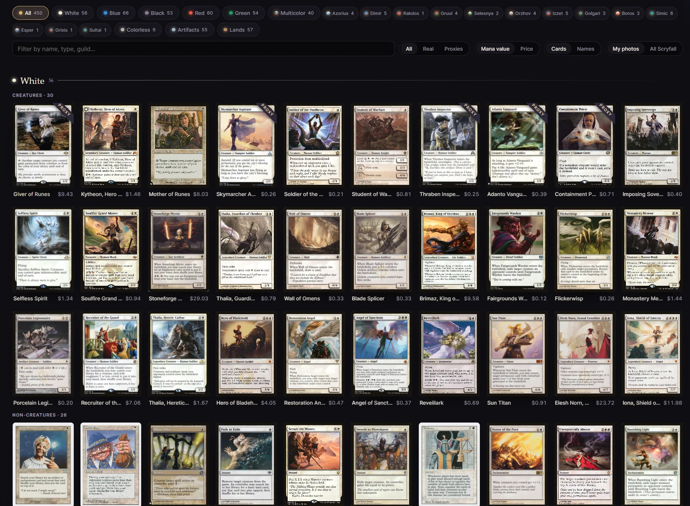
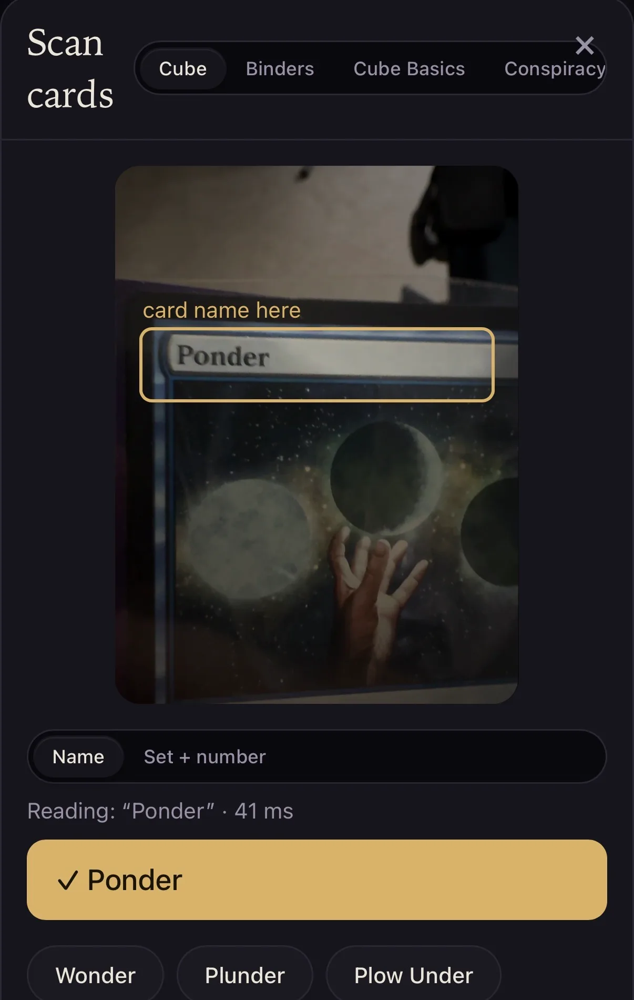
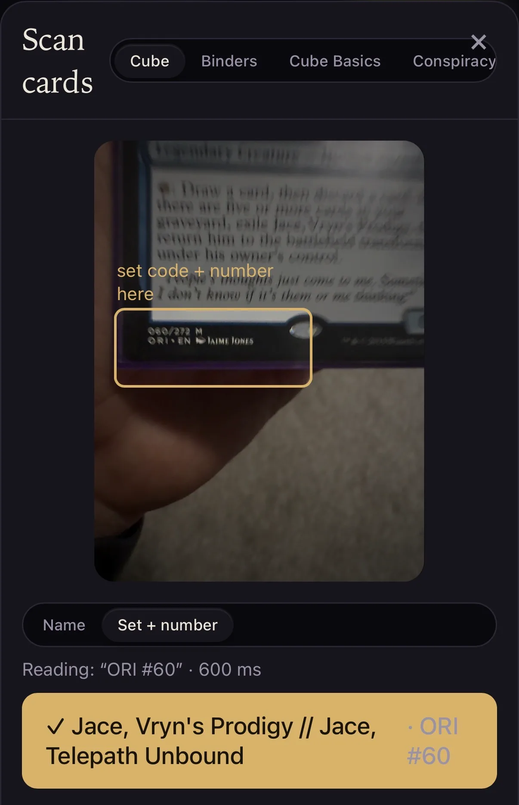

When I came across [this video](https://www.youtube.com/watch?v=Wzv_cSUvxgA) recently, I was inspired and said "[I can do that](https://www.youtube.com/watch?v=htEdMuuvyaI)!" I've been a heavy user of Notion for nearly a decade now, but there are things I don't like about it, and things that other apps have that I want. I adapted the video's prompt to my own preferences:

> Build me a hybrid app with the best features of Tana, Heptabase, Obsidian, and Notion (these should be community-agreed best features and the app should indicate what they are and not hide them). I'm told the Tana outlining experience is good. Obsidian for local folder access and markdown formatting / real-time editing. Markdown files should be handled in a local database in the tool for efficiency and visualization of the data on the level of Airtable quality. Use https://idiom.dannybrown.dev for design -- I think maybe the Ink theme might be appropriate here, but the red might be too strong, so prototype a few. The goal is achieved once I have a local app running, fully functionally tested end-to-end open on my main display. Don't ask clarifying questions along the way. Focus on building the app in an efficient, highly performant way, that will scale over time. A key part of this is my @../gtd/ system -- it's core to how I work, and I want a central tool that I find joyful to use and don't have to pay a monthly fee for.

My initial results were similar to what the video showed. I smoothed the rough edges and got things working satisfactorily. Then I proceeded to add additional features and integrations:

* Gmail
* Apple Health
* Habits tracking, with Apple Health integration
* Plaid for finance integrations -- budgeting, balances, Sankey charts, etc.
* A unifired calendar combining different sources into one great view
* Various custom views for databases I care about
* Toggleable themes in the setting for when I'm ready to switch things up
* My NYT Games account so that I auto-track my Connections + Wordle completion (and avoid forgetting and losing a streak!)

I don't have to just describe it -- I set up a sample version with demo data. I've dubbed it [Tarn](https://tarn.dannybrown.dev/#/today) in reference to the "mind like water" mentality that the Getting Things Done system entails. You can check out the [full list of feature inspirations here](https://tarn.dannybrown.dev/#/features).

This has also been a great level-up for me in terms of devops skills. How to ensure no data loss, industry-standard backup practices, security balanced with ease of accessibility -- all of these have been questions I've answered and grown my skills through.

I was showing this off and was asked "are you going to sell this?" I honestly have no plans or aspirations to do so. There's a plethora of apps like this hitting the market right now, and actually running a SaaS is a totally different beast from building a software product. There's a certain freedom coming from being the only user of a product, and I'll enjoy crafting this one to *my* exact specifications.

> This is my Tarn. There are many like it, but this one is mine.

## My First OCR App

I'm a lapsed *Magic: The Gathering* player, particularly the Cube format. I used to have my Cube catalogued on a website called Cube Tutor, but it went defunct and I didn't find out until my data was deleted. It's bothered me that my collection, unused as it's been for some time, is uncatalogued, so I set out to fix that.

I didn't care to search and type in every card I own, so I set out to create an OCR scanner I could use on my phone. This worked really nicely and I was able to get my collection catalogued over a single weekend, with a really nice web display as well:

This plugs into the Scryfall API and pulls card metadata, images, and prices, plus allows me to toggle for proxies and foils.

The OCR scanning works with card names:

And also with set codes + numbers for modern-frame cards:

Again, there's no shortage of sites like this on the market these days, so I folded the displays into Tarn and am keeping it as a tool just for me.

## Learning to Master Music

I've been a musician for over 30 years, but to be perfectly honest, I only sort of know how to mix and I only have a conceptual understanding of what "mastering" is, not how to do it. I've long been looking to fix this, but your standard Digital Audio Workstation (DAW) is very complex and represents a lot to learn, mostly with mouse clicks. As a keyboard-first computer user and a DAWless musician, I've just never been able to get off the ground with it.

I asked Claude to help me build an educational tool to help me learn to master, with the caveats that I want it to have the option to be completley keyboard driven and to have on-screen explainers of what and how everything does what it does. I need to dive in deeper, but early efforts are promising.

I've called it [Master Kit](https://master.dannybrown.dev/) and you can try it out yourself!

## Audio Visualization

Further connecting into my musicality, I've been interested in learning how audio visualization works in an attempt to create some more visually interesting videos. My goal was to be ultra sensitive to both timbre and rhythm.

I decided to use GLSL -- the OpenGL Shading Language -- which promised high-quality visuals due to calculating every pixel in parallel. By pre-analyzing a song (as opposed to reacting in real time), I found that it was possible to pretty reliably recognize buildups and set up big changes at appropriate times.

Finally, I adapted it to take not just an audio file but a video, then transition between real footage and the visuals. The results are pretty cool:

<iframe width="560" height="315" src="https://www.youtube.com/embed/oB_gg7ISFs4?si=eMcJO6ejo58L9oXm" title="YouTube video player" frameborder="0" allow="accelerometer; autoplay; clipboard-write; encrypted-media; gyroscope; picture-in-picture; web-share" referrerpolicy="strict-origin-when-cross-origin" allowfullscreen></iframe>

Again, you can try out [Music Shader](https://shader.dannybrown.dev) yourself!
